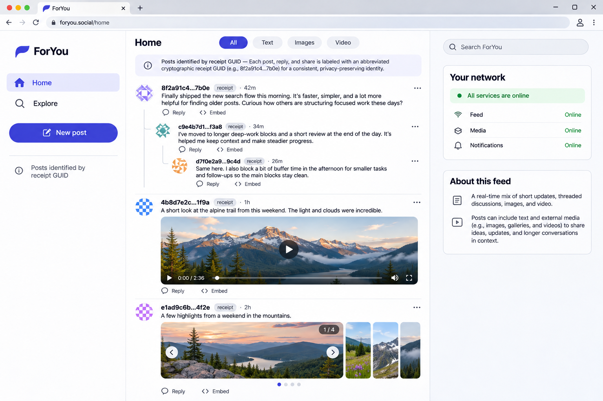

# ForYou reference platform

[](https://github.com/monstercameron/ForYou-social-reference-platform/actions/workflows/ci.yml)
[](LICENSE)
[](https://github.com/monstercameron/ForYou-Social-Ecosystem-Specification)

**The social network nobody owns.** [Project site](https://monstercameron.github.io/ForYou-social-reference-platform/) · [Specification](https://github.com/monstercameron/ForYou-Social-Ecosystem-Specification)



*Design concept for the client. Not a screenshot of a live network.*

ForYou is an open protocol for a social network built on public, signed text posts. Authors hold their own signing identity and choose where to publish. Anyone can read for free, and any application can verify and display the records. Posting costs about US$0.0001 per KiB, a fee set by the specification as an anti-spam hurdle and not by any provider. The aim is participation that does not depend on one company owning everyone's identity, audience or access to posts.

This repository is the Go reference platform for that protocol: one binary with four roles (client, provider, replica and foundation) and a server-rendered application. It is an early infrastructure demo and does not yet implement the protocol.

## Specification

The [ForYou specification](https://github.com/monstercameron/ForYou-Social-Ecosystem-Specification), release 1.0, is the source of truth for this project. When this README, the code or a design concept disagrees with it, the specification is right and the difference is a bug here.

| Topic | Specification document |
| --- | --- |
| Scope, actors and design goals | [Overview](https://github.com/monstercameron/ForYou-Social-Ecosystem-Specification/blob/main/docs/01-overview.md) |
| Signed messages, versions, replies, admission and content rules | [Protocol](https://github.com/monstercameron/ForYou-Social-Ecosystem-Specification/blob/main/docs/02-protocol.md) |
| Fees, settlement, distribution, retention and the Lifetime Vault | [Economics](https://github.com/monstercameron/ForYou-Social-Ecosystem-Specification/blob/main/docs/03-economics.md) |
| Provider accountability and rights | [Compliance](https://github.com/monstercameron/ForYou-Social-Ecosystem-Specification/blob/main/docs/04-compliance.md) |
| Public download, incremental sync and provider exit | [Portability](https://github.com/monstercameron/ForYou-Social-Ecosystem-Specification/blob/main/docs/05-portability.md) |
| Foundation, release keys and versioning | [Governance](https://github.com/monstercameron/ForYou-Social-Ecosystem-Specification/blob/main/docs/06-governance.md) |
| What a client must do | [Clients](https://github.com/monstercameron/ForYou-Social-Ecosystem-Specification/blob/main/docs/07-clients.md) |
| Routes and errors | [API catalog](https://github.com/monstercameron/ForYou-Social-Ecosystem-Specification/blob/main/docs/API-catalog.md) |

The specification repository also holds the JSON schemas (`schemas/`), signed test vectors and an executable economics model (`tests/`). The protocol code written here is to be tested against those vectors.

## Goals

- **Make publishing portable.** Authors control their signing identity and can choose another provider; applications can verify signed records independently.
- **Keep reading open.** Anyone should be able to retrieve available public posts without paying or creating a reader account, subject to provider limits and applicable restrictions.
- **Keep the network focused.** The core handles signed posts, paid admission, public retrieval, replies and versions. Applications can build their own feeds, discovery and other social features.
- **Support independent operation.** Providers run independently and users choose whom to trust. There is no network token, global feed or mandatory directory. The shared parts are few and public: the ForYou Foundation receives the fees, and a committee of independent monitors audits settlement.
- **Make costs understandable.** Fee schedule 1 charges 136 millisatoshis or 48,900,000,000 wei per started KiB, about US$0.0001. Authors pay from a provider-local balance funded in Bitcoin or Ethereum. Providers settle the whole fee to the Foundation, which returns up to half each quarter, more for better measured quality and longer proven retention.
- **Leave media hosting to users and applications.** Posts can refer to externally hosted images and videos; the network stores the text and signed references, not the media files.
- **Build for longevity.** Each provider declares a retention period of at least one year. The Foundation funds and owns a Lifetime Vault that keeps settled posts with no scheduled expiry. Providers can fail or locally restrict access, and indefinite availability cannot be guaranteed.

These goals do not guarantee global availability, legal compliance, sustainable economics, or security. Those require design, implementation, testing and independent review.

## Who it is for

Authors can publish posts and replies through a provider they choose. Readers can download available posts and follow conversations without a publishing account. Independent operators can offer admission and storage services, while app developers and indexers can build different ways to discover and present public records.

## How it is intended to work

1. An author creates and backs up a signing identity, chooses a provider and funds a provider-local balance.
2. The author composes a text post, optionally with up to 16 links to externally hosted images or videos. The provider supplies a fee quote tied to the exact post.
3. The author approves the fee; the provider admits the post and issues a receipt. The signed record can then be published and retrieved.
4. Readers and apps retrieve records from selected providers and verify signatures and receipts. Replies refer to a particular post version; an edit creates another signed record rather than changing the original.

This flow is the intended design, not a working feature today. Providers do not automatically know every post in the network, and results depend on the sources a reader queries.

## Project status

**This repository is an infrastructure demo, not a working social network or provider.** It has four server roles, HTTPS health and database-readiness endpoints, and a client feed with mock data and HTMLeX-powered interactions. PostgreSQL connections can be configured independently for each role. It does not implement real posts, cryptographic verification, accounts, persistent application data, payments, federation, or replication.

Do not use real funds, sensitive information, or real signing keys with this code. The specification and implementation will evolve together as the design is tested.

## Funding and reading

The intended design uses a provider-local prepaid balance funded with Bitcoin or Ethereum. An author would compose a post, obtain and approve a quote for its exact contents, authorize the fee, and sign the post after the provider issues a receipt. The provider settles the entire fee to the ForYou Foundation with prepaid on-chain deposits and signed claims that a committee of independent monitors audits. Each quarter the Foundation returns part of it to the provider according to measured quality and proven retention. The fee schedule is fixed by the specification; the payment implementation here is not started. A provider-local balance is held by that provider and does not automatically transfer to another one; provider failure or insolvency may put it at risk.

Readers would select providers, download posts and verify their signatures and receipts. A provider's response represents that provider's available records, not a complete view of the entire network. Applications can group replies and post versions while preserving the exact signed records and their original links.

## Persistence and safety

Each provider declares how long it retains posts, with a minimum of one year, subject to applicable local legal restrictions. The Foundation's Lifetime Vault keeps settled posts with no scheduled expiry. These are obligations, not a guarantee that every provider or copy will survive. Public posts and all versions can be copied indefinitely; publishing a new version cannot erase copies of an earlier one. Authors will need clear warnings before publishing.

The network stores text and signed metadata. The author or application chooses and manages any media host. Admission does not fetch those media URLs. Media availability, safety, and ownership are separate from the post; a content hash can detect a change but cannot guarantee that the media remains available.

## Architecture and technology

The initial implementation will favor a small, understandable stack:

| Area | Direction | Status |
| --- | --- | --- |
| Server | Four Go server roles, HTTP/3 and HTTP/1.1 over TLS | Infrastructure demo exists |
| User interface | Server-rendered HTML, with [HTMLeX](https://github.com/monstercameron/HTMLeX) for declarative interactions and HTML fragments | Mock feed, filters and in-memory demo posts exist |
| Data | PostgreSQL connections, configured separately per role | Readiness checks implemented; no application schema yet |
| Protocol | Shared Go packages for message processing and verification | Planned |
| Quality | Go tests, `go vet`, formatting checks, and GitHub Actions | Starter checks exist |
| Planning | [GitHub Issues](https://github.com/monstercameron/ForYou-social-reference-platform/issues) | Open |

HTMLeX is a browser runtime for server-driven interactions, so the application can use Go-rendered pages and fragments without a separate single-page application. The server must escape untrusted content and protect state-changing requests. The design for author-controlled signing and protected keys in an SSR application still needs to be worked out; server rendering alone does not solve key custody.

The client vendors the HTMLeX browser runtime under `internal/server/static/htmlex`, with its source revision, local patch and license alongside it. Go renders the initial page and response fragments. Filters and search use ordinary page navigation so browser back and forward restore their URL and results. HTMLeX powers incremental feed loading, replies, slideshow controls, sharing panels, the byte-count preview and demo post submission. Application JavaScript initializes HTMLeX, detects when text needs a disclosure control, and restores keyboard focus after selected fragment swaps.

The mock feed includes light and dark appearances, text, example videos, an illustrated slideshow, and threaded replies. Explore searches and filters records available to this demo server. Settings controls appearance and can clear thumbs-up or thumbs-down feedback. Feedback is stored in browser cookies and sent to the server with requests. The 24 most recent selections are used; overlapping updates near the limit can temporarily leave extra cookies until the next update. Separate posts use separate cookies so concurrent choices on different posts do not overwrite one another. Competing updates to the same post or a simultaneous clear can still race. Feedback does not train a model or change feed ordering yet.

The New post page can count text bytes and add a demo post to the client server's bounded in-memory store. Demo posts are visible to visitors to that server and disappear on restart; they are not signed or sent to a provider. Pricing and payment are not available. Mock receipt labels are generated from sample data and are not transaction receipts. The included flower video is from [MDN's CC0 media examples](https://interactive-examples.mdn.mozilla.net/media/cc0-videos/flower.mp4); the landscape illustrations are local mock assets.

Visual references for the intended client, including light and dark feed concepts, are in [docs/concepts](docs/concepts/). They are design explorations rather than implemented features or protocol guarantees.

Each mock feed post has a post page and an embeddable view. The Embed control reveals the post URL and iframe code. Set `FORYOU_PUBLIC_ORIGIN` to the client server's externally reachable HTTPS origin to generate links for another host; otherwise links use `https://127.0.0.1:8443` and only work on the local machine. External embedding requires a publicly reachable server with a trusted TLS certificate. These demo URLs and IDs are not yet protocol post identifiers.

The protocol uses signed records, provider receipts, provider-local balances, and persistent storage. Exact APIs, schema migrations, deployment topology, wallet integration, and operational controls will be implemented and tested as the project develops. No payment, availability, or compliance guarantee is implied by this scaffold.

## Getting started

### Requirements

- Go 1.27 or newer.
- Git for version control.

The HTTP demo requires no Node, database, Docker, or crypto wallet. A PostgreSQL server is needed to demonstrate a successful database connection. Go downloads the dependencies listed in `go.mod` on the first build.

The [project site](https://monstercameron.github.io/ForYou-social-reference-platform/) is a static page, [docs/index.html](docs/index.html), published by GitHub Pages from the `docs` folder of the `master` branch.

### Configure the demo

Copy `.env.example` to `.env` and generate a local development certificate:

```powershell
Copy-Item .env.example .env
go run ./cmd/devcert
```

The certificate is self-signed for localhost and is **not trusted by browsers by default**. It is for local development only. `.env` and `.local/` are ignored by Git. The generator refuses to overwrite an existing key or certificate. To connect a role to PostgreSQL, set its `FORYOU_<ROLE>_DATABASE_URL` in `.env`; use separate databases and credentials as appropriate. Empty URLs leave that role's database unconfigured. Process environment variables override `.env`.

### Run the servers

Run each command in a separate terminal from the project directory:

```sh
go run ./cmd/foryou -role client
go run ./cmd/foryou -role foundation
go run ./cmd/foryou -role provider
go run ./cmd/foryou -role replica
```

The default ports are client **8443**, foundation **8444**, provider **8445**, and replica **8446**, bound to loopback. Override a role's address with `FORYOU_<ROLE>_ADDR`. Each process serves `GET /healthz` for process health and `GET /readyz` to check its own PostgreSQL connection. Readiness returns 503 if the database is unconfigured or unreachable. The client root is a simple server-rendered page; the other roots identify their roles. The page's example links use the default ports.

Each server listens on UDP for HTTP/3 and TCP for HTTPS HTTP/1.1 on the same port. HTTP/1.1 responses advertise HTTP/3 using `Alt-Svc`; clients decide whether and when to upgrade and may initially connect over TCP. If the UDP listener cannot bind at startup, the server logs the failure and serves HTTP/1.1 without advertising HTTP/3. If HTTP/3 stops later, HTTP/1.1 remains available and sends `Alt-Svc: clear`. Compatible GET responses negotiate Brotli or gzip using `Accept-Encoding`. Example verification with a TLS client that supports HTTP/1.1:

```sh
curl --cacert .local/localhost.crt https://127.0.0.1:8443/healthz
```

Open the local client page in a browser only after arranging appropriate trust for the local development certificate. Do not use it for production. Stop each process with `Ctrl+C`.

### Client styling and demo posts

The client uses HTMLeX for server-rendered interactions and a locally compiled Tailwind stylesheet. Install Node.js, run `npm ci`, and rebuild the generated stylesheet with `npm run build:css` after changing templates or `internal/server/styles/tailwind.css`. The generated CSS is committed and embedded in the Go binary, so running the server does not require Node.js or a CDN. Component styles and theme tokens live under `internal/server/styles/`.

The composer can add text posts to a bounded, in-memory demo feed shared by visitors to the client server. Demo posts disappear on restart; they are not signed, paid, or sent to a provider. Filtering and search use normal GET navigation so browser history restores the correct view.

### Run checks

```sh
go test ./...
go vet ./...
```

Enable the pre-commit hook once per clone with `git config core.hooksPath .githooks`. Both hooks run three steps: format (`gofmt`), lint (`go vet`, plus `staticcheck` when it is installed) and test. The pre-commit hook covers only the Go packages you staged; the pre-push hook covers the whole module, so nothing reaches the remote unchecked. Each change lands as one commit and is pushed at once.

Follow the [Go style decision](docs/adr/0001-go-style.md), the [testing strategy](docs/adr/0002-testing-strategy.md) and the [architecture decision](docs/adr/0003-architecture.md). Format Go files with `gofmt`. The [GitHub Actions workflow](.github/workflows/ci.yml) checks formatting, runs tests, and runs `go vet` on pushes and pull requests.

## Repository layout

```text
cmd/foryou/                  Entry point for the four demo roles
cmd/devcert/                 Local development certificate generator
internal/server/             HTTP routes and server tests
internal/server/templates/   Server-rendered HTML templates
internal/transport/          HTTP/3 and HTTP/1.1 listeners
docs/index.html              Project site (GitHub Pages)
docs/adr/                    Engineering decisions
docs/concepts/               Client design concepts
.github/workflows/           GitHub Actions checks
go.mod                       Go module and toolchain requirement
```

## Planned work

The order and scope are tracked in [GitHub Issues](https://github.com/monstercameron/ForYou-social-reference-platform/issues). Early work includes:

1. Integrate and test HTMLeX with Go-rendered HTML and establish safe template and request handling.
2. Design storage and migrations, then implement public post retrieval and date filtering.
3. Build and test message encoding, signatures, receipt verification, and interoperability against the specification's vectors.
4. Design user-controlled key creation, signing, and backup for the server-rendered experience.
5. Implement posting, replies, version handling, and external media references.
6. Design and test provider balances, fee quoting, and payment integration before supporting real funds.
7. Add operator configuration, deployment guidance, observability, and independent security review.

This is a starting roadmap, not a release schedule. In particular, payment rates, economic sustainability, key custody, and operational/legal requirements need further work before launch.

## Contributing

Use [issues](https://github.com/monstercameron/ForYou-social-reference-platform/issues) and pull requests for discussion and changes. Protocol questions belong in the [specification repository](https://github.com/monstercameron/ForYou-Social-Ecosystem-Specification/issues). Keep changes focused, run the checks above, and document behavior and limitations alongside new features. Security-sensitive protocol and payment changes require careful review and meaningful tests.

## License

ForYou is released under the [MIT License](LICENSE). The specification is MIT licensed as well.
